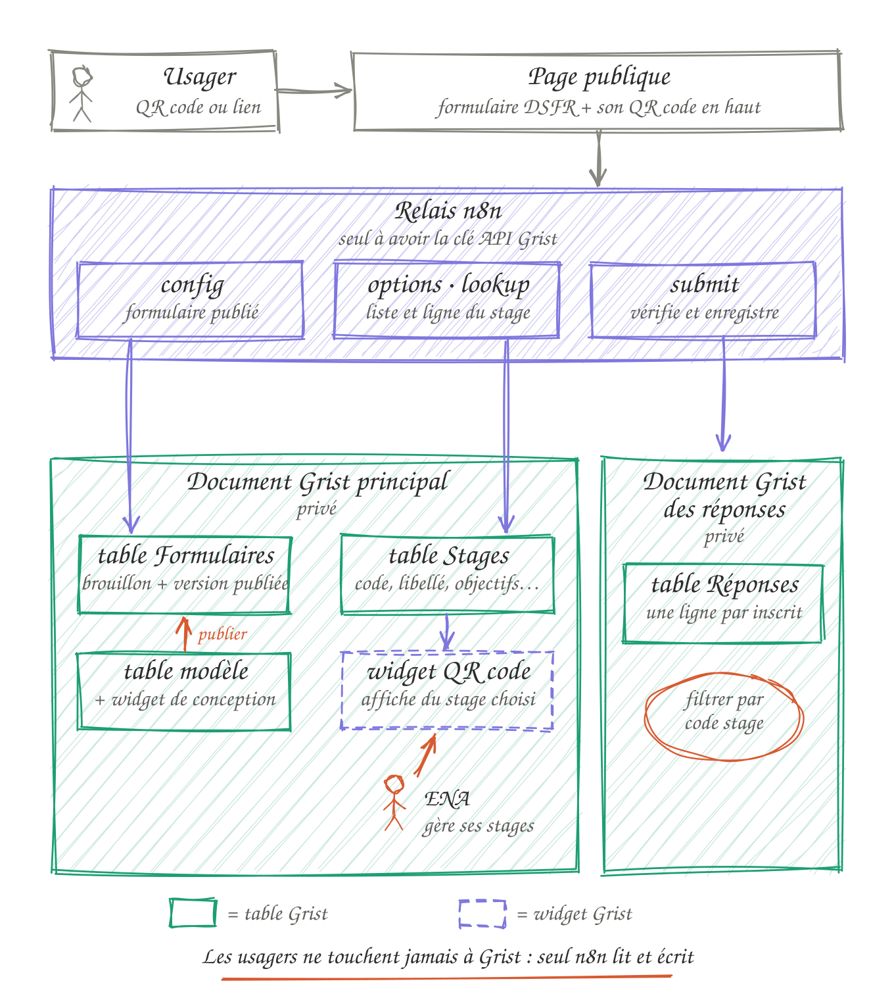

# Sparrow – formulaire DSFR pour Grist

Formulaires publics au design de l'État (DSFR, inspiré de Démarche Numérique), conçus dans Grist et servis via un relais n8n.

## Adresses une fois GitHub Pages activé
- Widget de conception et page publique : `https://jlllyfish.github.io/sparrow-widget-form-dsfr/index.html`
- Widget QR code : `https://jlllyfish.github.io/sparrow-widget-form-dsfr/qrcode.html`

Pour activer GitHub Pages : **Settings → Pages → Build and deployment**, choisissez « Deploy from a branch », la branche `main` et le dossier `/ (root)`.

Les pages ne dépendent d'aucun site externe : le DSFR (v1.12.1, polices et icônes) et la bibliothèque de QR code sont inclus dans le dossier `vendor/`. Dans Grist, l'API des widgets est chargée depuis l'instance Grist elle-même, avec docs.getgrist.com en secours.

## Principe : un formulaire matrice qui s'adapte à la formation choisie
Un **seul formulaire**, configuré une fois : les questions sont toujours les mêmes, seuls le titre et les informations de la formation changent. Chaque nouvelle ligne de la table Stages reçoit **automatiquement** son lien et son QR code, sans rien reconfigurer.

1. L'usager choisit la formation dans une **liste avec recherche** : il tape « NAS0 » ou un mot de l'intitulé. Avec un lien ou un QR code par formation, le code est déjà rempli.
2. La ligne de cette formation, dans une table Grist, remplit les **éléments non saisissables** du formulaire : titre, sous-titre, sections et blocs de texte (dates, lieu, formateur, objectifs…).
3. Les questions d'évaluation suivent. La réponse est enregistrée avec le code de la formation.

## Mise en place

Trois fichiers :
- `index.html` : sert à la fois de widget Grist (pour concevoir le formulaire) et de page publique (pour les répondants).
- `qrcode.html` : un petit widget Grist qui affiche le QR code du stage sélectionné. Il se place à côté de la table Stages.
- `n8n/workflow-n8n-formulaire-dsfr.json` : le relais n8n entre la page publique et Grist.

Le schéma `docs/schema-formulaire-dsfr-croquis.svg` résume l'ensemble.

Les répondants n'ont jamais accès au document Grist.

## Organisation des données
- **Document principal** :
  - le widget de configuration ;
  - la table `Formulaires` : une ligne par formulaire, avec le **brouillon** (bouton Enregistrer du widget) et la **configuration publiée** (bouton Publier), lue par n8n ;
  - la table `Stages`, avec les colonnes Code, Intitulé, Dates…, **Lien** (formule ajoutée à la publication) et, si vous le souhaitez, **Inscriptions ouvertes** (cochée par défaut sur chaque nouvelle ligne) ;
  - une table de **réponses par formulaire** (par défaut `Reponses_<identifiant>`), **créée automatiquement à la publication** avec une colonne par question.
- **Document des réponses** (facultatif) : une table avec les **mêmes identifiants de colonnes** que la table de réponses du document principal, qui sert de modèle. Toutes les réponses publiques y arrivent. Le code stage est enregistré dans une colonne : filtrez ou regroupez par stage dans Grist.

## 1. Héberger `index.html` et `qrcode.html`
Ce dépôt est prévu pour GitHub Pages (voir plus haut). Une seule copie suffit pour tous vos formulaires.

Pour obtenir des liens plus courts, inscrivez l'URL du webhook n8n dans la constante `DEFAULT_API`, en haut du fichier. Le paramètre `&api=…` disparaît alors des liens et des QR codes.

## 2. Ajouter le widget dans Grist
1. Sur n'importe quelle page, ajoutez un widget **Personnalisé** avec l'URL de `index.html` (adresse GitHub Pages ci-dessus) et l'accès **complet** au document. Un seul widget gère **tous les formulaires** du document.
   - Posé sur la table `Formulaires`, il affiche le formulaire de la ligne sélectionnée.
   - Posé sur une autre table, il affiche le formulaire dont les réponses vont dans cette table (ou le seul formulaire du document).
2. Cliquez sur **Créer un formulaire** (ou « Nouveau formulaire » en haut de la configuration). Un **assistant en 4 étapes** vous guide :
   1. **Nom** du formulaire (l'identifiant utilisé dans les liens est proposé automatiquement) ;
   2. **Formation choisie** : la table des formations (ex. Stages), la colonne du code, celle de l'intitulé, les colonnes à afficher (dates, lieu, objectifs…) et, si besoin, la case « inscriptions ouvertes » ;
   3. **Questions** : un modèle de départ (évaluation, inscription ou vide) ;
   4. **Récapitulatif**, puis « Créer le formulaire ».
3. La configuration s'organise ensuite en onglets :
   - **1. Formulaire** : identifiant, **présentation**, textes, table des réponses, logo et en-tête de l'État.
     En « une section par écran », l'élément **Saut de page** (onglet 3) coupe une section en plusieurs écrans qui gardent le même titre. La page de confirmation peut proposer « Déposer une nouvelle réponse » (case à cocher, désactivée par défaut).
     Présentation *tout sur une page*, ou **écran par écran** (une question, ou une section, à la fois) : accueil avec les informations du stage, boutons « Précédent » et « OK » (ou touche Entrée), barre de progression, récapitulatif avec « Modifier » avant l'envoi. Conçu pour le téléphone : grandes cases de choix, boutons en bas d'écran, le bouton retour du téléphone revient à la question précédente ;
   - **2. Formation choisie** : la règle de préremplissage. Pour chaque colonne de la ligne choisie, l'élément qui l'affiche : titre, section, bloc de texte ou champ ;
     emplacements **Référence sous le titre** (étiquettes, ex. code du stage et « Session 2 », avec un « texte avant la valeur » réglable), **Date de début** et **Date de fin** (« Du 03/12/2026 au 05/12/2026 ») ; la référence est rappelée à gauche du pied de page (case « Rappeler la référence dans le pied de page ») ;
     pour **un formulaire par stage + session**, ajoutez dans Stages une colonne formule de clé, ex. `$Code_Stage + "-S" + str($Session)`, et choisissez-la comme colonne du code ;
     le **code** et l'**intitulé** du stage sont enregistrés avec chaque réponse (l'intitulé via un « champ caché »). Pour un formulaire créé avant cette version, cliquez sur « Les enregistrer dans les réponses », puis sur Publier ;
   - **3. Questions** : ajout, ordre, conditions d'affichage, validation. « Colonne où enregistrer la réponse » : *Nouvelle colonne* (créée à la publication), une colonne existante, ou *Ne pas enregistrer* ;
   - **4. Publication** : adresses n8n et page publique, lien général ;
   - **5. Liens et QR codes** : un lien, un QR code et une affiche par formation ;
   - **Avancé** : import / export de la configuration.
4. Le menu **Formulaire** en haut permet de passer d'un formulaire à l'autre ; **Dupliquer** crée une copie (avec sa propre table de réponses). Les adresses n8n et de la page publique, le logo et l'en-tête sont repris automatiquement du formulaire précédent.

5. **Ajouter une formation** = ajouter une ligne dans Stages. Sa colonne **Lien** se calcule seule, le widget QR code l'affiche, et le formulaire la propose dans la liste. Pour fermer une formation, décochez sa case « Inscriptions ouvertes ».

   « Autre formulaire » n'est utile que pour un questionnaire **différent** (autres questions). La colonne « Formulaire » de Stages ne sert alors qu'à répartir les formations entre ces questionnaires ; avec un seul formulaire, elle est inutile.

**Accueil du widget** : l'état du formulaire (publié, brouillon, modifications non publiées), **« Voir le formulaire d'un stage »** (aperçu exactement comme avec le lien ou le QR code de ce stage, rien n'est enregistré), et les raccourcis Configurer, Liens et QR codes, Formulaire public.

## 2 bis. Ajouter le widget QR code à côté de la table Stages
1. Ajoutez un widget **Personnalisé** avec l'URL de `qrcode.html`, sélectionné par la table Stages.
2. Dans le panneau de droite, associez les colonnes : **Lien** (obligatoire), Titre (Intitulé), Code, Détails (Dates) et Ouvert (Inscriptions ouvertes).

L'ENA sélectionne son stage et obtient directement :
- le QR code ;
- le lien à copier ;
- l'affiche à imprimer ;
- les affiches de tous les stages ouverts, d'un seul coup.

Il ouvre ou ferme lui-même les inscriptions en cochant ou décochant la case de son stage.

## 3. Installer le relais n8n
1. Dans n8n, importez le fichier `n8n/workflow-n8n-formulaire-dsfr.json`.
2. Créez une identification **Header Auth** nommée « Grist API » :
   - nom : `Authorization` ;
   - valeur : `Bearer <votre clé API Grist>`.

   Sélectionnez-la dans les 6 nœuds HTTP du workflow.
3. Dans le nœud **Paramètres**, renseignez l'URL de Grist et l'identifiant du document principal, qui contient les tables Formulaires, Stages et la table modèle des réponses.
4. Activez le workflow et copiez l'**URL de production** du nœud Webhook.

La clé API doit appartenir à un compte qui a au moins accès en lecture complète aux documents utilisés pour le préremplissage. C'est nécessaire parce que n8n interroge ces documents via l'endpoint `/sql` de Grist.

## 4. Publier
Dans le widget, onglet **4. Publication** :
1. Renseignez l'URL du webhook n8n et l'adresse de la page publique (reprises automatiquement pour les formulaires suivants).
2. Cliquez sur **Publier**. La table des réponses est créée (ou complétée des colonnes manquantes), la colonne **Lien** de Stages est créée ou mise à jour, puis le brouillon enregistré dans la table `Formulaires` devient la version en ligne. Sans l'adresse du webhook n8n, aucun lien ni QR code n'est généré, car le formulaire public ne pourrait pas fonctionner.
3. **Destination des réponses publiques** : indiquez l'identifiant du document des réponses et le nom de sa table. Laissez vide pour enregistrer dans le document principal.
4. **Un lien et un QR code par formation** : le lien public général ouvre le formulaire sans formation choisie. Ici, chaque formation reçoit son propre lien, qui ouvre le formulaire déjà adapté à elle. Choisissez le champ qui reçoit le code de la formation : la liste des formations s'affiche, avec pour chacune :
   - son lien à copier, à envoyer par courriel aux personnes sans téléphone ;
   - son QR code ;
   - son affiche à imprimer.

   Vous pouvez aussi imprimer toutes les affiches d'un coup, ou exporter tous les liens en CSV.

   Le lien ouvre le formulaire avec le code déjà rempli et verrouillé, et les informations du stage préremplies.
5. **Afficher aussi le QR code en haut du formulaire** : pratique sur un écran partagé ou en salle, pour continuer l'inscription sur son téléphone. Le QR code suit le code stage saisi. Il est masqué sur les petits écrans.

À chaque modification du formulaire, cliquez de nouveau sur **Publier**. Pour suspendre un formulaire, décochez la case `Publie` dans la table `Formulaires`.

## Ce que fait le relais n8n
- **config** : renvoie le formulaire publié, sans aucun détail interne (ni colonnes, ni tables, ni documents).
- **options** : renvoie la liste des codes (et intitulés) proposés dans le champ « Choix dans une table ». Seules les formations rattachées au formulaire et ouvertes y figurent.
- **lookup** : renvoie uniquement les éléments à afficher ou préremplir pour la ligne choisie. La comparaison ignore la casse et les espaces. Il est impossible de télécharger la table entière. Il signale aussi si les inscriptions sont closes, et ignore les stages rattachés à un autre formulaire.
- **submit** : refait côté serveur toutes les vérifications du navigateur : champs obligatoires, expressions régulières, conditions, options proposées, et code stage existant, rattaché à ce formulaire et ouvert. Les champs masqués sont ignorés, ainsi que les colonnes non prévues. Un champ piège invisible bloque les robots.

## Mettre à jour le workflow n8n
Inutile de réimporter le workflow à chaque évolution : `n8n/MISES-A-JOUR.md` indique les seuls nœuds à modifier, et `n8n/noeuds/` contient le code à coller dans chacun.

## Vérifier que tout fonctionne
Dans le widget, onglet **4. Publication**, le bouton **Tester la connexion** vérifie que :
- n8n répond, et avec la bonne version du workflow ;
- le formulaire est publié et lu par n8n ;
- les dernières modifications sont publiées ;
- la liste de choix contient bien des formations ;
- le préremplissage fonctionne, en le testant avec la première formation de la liste.

Si le navigateur affiche une erreur CORS, vérifiez l'option *Allowed Origins (CORS)* du nœud Webhook. Elle vaut `*` par défaut ; vous pouvez y mettre l'adresse de votre page publique.
